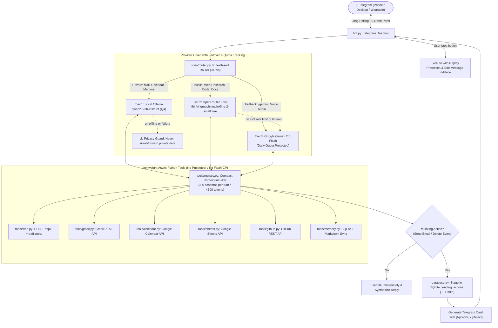
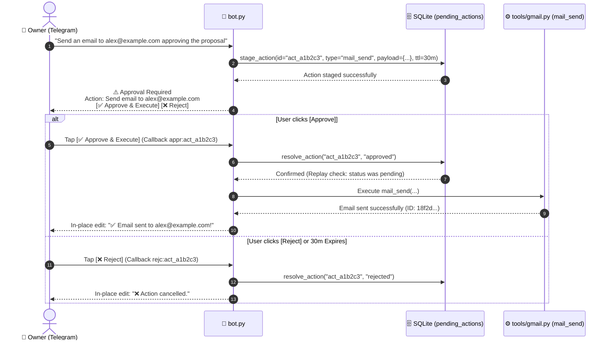
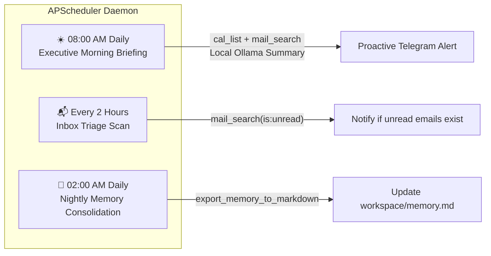

# 🌟 Hope UltraLight — Personal Executive AI Agent

[](https://www.python.org/)
[](https://opensource.org/licenses/MIT)
[](https://core.telegram.org/bots)
[](https://ollama.com/)
[](#️-3-tier-brain-architecture)
[](#️-privacy-boundaries--human-in-the-loop-safeguards)
[](#-cost--resource-efficiency)

**Hope** is a calm, discreet personal executive AI agent: a lean, single-process, privacy-conscious system built on a **3-Tier Brain Architecture** and operated entirely through **Telegram**.

Designed specifically to run 24/7 on edge hardware (such as an old laptop or low-power mini-PC), Hope manages your schedule, monitors and drafts emails, conducts deep public research, records enduring memory, and executes routines without requiring bulky browser runtimes, paid cloud subscriptions, or exposed public network ports.

---

## 📑 Table of Contents

- [✨ Why Hope UltraLight?](#-why-hope-ultralight)
- [🏗️ 3-Tier Brain Architecture](#️-3-tier-brain-architecture)
- [⚡ Core Capabilities & Tool Ecosystem](#-core-capabilities--tool-ecosystem)
- [🔒 Human-in-the-Loop & Approval Gate](#-human-in-the-loop--approval-gate)
- [🖥️ Hardware & Resource Footprint](#️-hardware--resource-footprint)
- [🚀 Quick Start Guide](#-quick-start-guide)
  - [Prerequisites](#prerequisites)
  - [Debian / Ubuntu Linux (Recommended for 24/7 Server)](#debian--ubuntu-linux-recommended-for-247-server)
  - [Windows 10 / 11 (Development)](#windows-10--11-development)
  - [macOS (Apple Silicon & Intel)](#macos-apple-silicon--intel)
- [🔑 Environment Configuration (`.env`)](#-environment-configuration-env)
- [🔐 Google Workspace OAuth Setup](#-google-workspace-oauth-setup)
- [🧪 Diagnostics & Smoke Testing](#-diagnostics--smoke-testing)
- [📱 Telegram Commands & Usage Examples](#-telegram-commands--usage-examples)
- [⏰ Autonomous Scheduled Routines](#-autonomous-scheduled-routines)
- [🛡️ Security Architecture & Privacy Safeguards](#️-security-architecture--privacy-safeguards)
- [🧪 Running the Test Suite](#-running-the-test-suite)
- [📂 Project Directory Structure](#-project-directory-structure)
- [❓ Frequently Asked Questions & Troubleshooting](#-frequently-asked-questions--troubleshooting)
- [📄 License](#-license)

---

## ✨ Why Hope UltraLight?

Traditional AI agents rely on heavy multi-container Docker runtimes, resource-intensive Puppeteer/Selenium headless browsers, and continuous cloud API billing. Hope UltraLight is engineered from the ground up for **extreme efficiency, privacy isolation, and zero-maintenance reliability**:

| Feature / Metric | Traditional Heavy Agents (AutoGPT / OpenClaw) | Hope UltraLight |
| :--- | :--- | :--- |
| **RAM Consumption** | 2 GB – 8 GB+ (Node.js, headless Chromium) | **~20 MB – 50 MB** (Direct Python HTTP stack) |
| **Network Exposure** | Webhooks requiring open inbound ports or ngrok | **0 open ports** (Outbound HTTPS long polling) |
| **Private Data Leakage** | All personal data piped directly to cloud LLMs | **Strict Local Wall**: Emails, calendar, and notes stay on Tier 1 Ollama |
| **Cloud Operating Cost** | \$20 – \$100+/month in API tokens | **\$0.00 / month** (Ollama + OpenRouter Free tier) |
| **Executive Interface** | Localhost browser UI or terminal CLI | **Telegram Mobile & Desktop** (Push notifications + 1-click inline buttons) |
| **Mutating Action Safety** | Autonomous file deletion or email spam risk | **Human-in-the-Loop Gate** with UUID replay protection & 30-min TTL |
| **Prompt Token Overhead** | Injects 20–50 tool schemas per turn (>3,000 tokens) | **Contextual Registry**: Injects 3–6 compact schemas (<300 tokens) |
| **Deployment Footprint** | Docker Compose, Redis, Vector DB, PostgreSQL | **Single Python Process** with built-in SQLite3 |

---

## 🏗️ 3-Tier Brain Architecture

Hope UltraLight organizes reasoning across three distinct tiers to balance complete privacy, high-speed free intelligence, and resilient fallback:



### 1. Tier 1: Local Edge Brain (Ollama — `qwen2.5:3b-instruct`)
- **Role**: Private personal data handling, email triage, calendar agenda extraction, memory notes, and simple conversational responses.
- **Hardware Profile**: 4-bit quantized (Q4) model consuming ~2.2 GB RAM, runs at 15–25 tok/s on an Intel Core i7-6600U laptop CPU.
- **Privacy Guarantee**: **0 cloud tokens**. Personal schedule, private correspondence, and personal secrets are never transmitted over the internet.
- **Optional Deep Mode**: Switchable to `qwen2.5:7b-instruct-q4_K_M` for local complex reasoning.

### 2. Tier 2: Free Cloud Workhorse (OpenRouter — `inkling-2-small:free`)
- **Role**: High-throughput public research, web scraping synthesis, code debugging, and long document distillation.
- **Model Specs**: Thinking Machines Inkling 2 Small Free (17B active / 594B total MoE architecture, 1M context window, ~115 tok/s).
- **Cost**: **100% Free** through OpenRouter's free tier.
- **Response Caching**: Deterministic public queries are cached in SQLite for 4 hours to avoid redundant network round-trips.

### 3. Tier 3: Cloud Fallback & Audio Transcriber (Google Gemini 2.5 Flash)
- **Role**: Automatic failover whenever Tier 2 experiences rate limits (HTTP 429) or upstream timeouts, manual cloud override via `/gemini`, and high-accuracy audio transcription of Telegram voice messages (`.oga`).
- **Quota Safeguard**: Tracked by a hard daily request counter in SQLite (default: 50 requests/day) to prevent unexpected usage.

---

## ⚡ Core Capabilities & Tool Ecosystem

Hope UltraLight includes an asynchronous tool suite designed for sub-second execution without browser dependencies:

| Integration | Tool Functions | Description & Safeguard |
| :--- | :--- | :--- |
| **🌐 Web Research** | `web_search`<br/>`fetch_page`<br/>`company_brief` | DuckDuckGo search + `httpx` + `trafilatura` article extraction. Uses ~20 MB RAM vs 800 MB for Chromium. Generates structured executive briefs for companies and founders. |
| **✉️ Gmail** | `mail_search`<br/>`mail_read`<br/>`mail_draft`<br/>`mail_send` | Search user inbox (`is:unread`), decode multipart MIME emails, create draft replies for human review, and send emails (**mutating action guarded by 1-click approval**). |
| **📅 Google Calendar** | `cal_list`<br/>`cal_add`<br/>`cal_delete` | Scan upcoming schedules for specified days, schedule new events with ISO datetimes, and remove events (**mutating action guarded by 1-click approval**). |
| **📊 Google Sheets** | `sheet_append` | Append rows to Google Sheets for automated CRM tracking, lead capture, founder research logs, or meeting minutes. |
| **🐙 GitHub** | `gh_issues`<br/>`gh_read_file` | Read open issues and pull requests, inspect repository source files, and review codebases with token-based access and repository whitelisting. |
| **🧠 SQLite Second Brain** | `remember`<br/>`recall` | Store enduring facts and preferences into SQLite with auto-categorization. Exported automatically to human-readable `workspace/memory.md`. |
| **✅ Tasks & Reminders** | `create_task`<br/>`list_tasks`<br/>`complete_task`<br/>`cancel_task` | Persist follow-ups locally in SQLite and receive one-shot Telegram reminders when they become due. |
| **🎙️ Voice Notes** | Gemini Audio API | Send a Telegram voice memo from your phone. Gemini transcribes the audio in seconds, and Hope executes the instruction immediately. |

---

## 🔒 Human-in-the-Loop & Approval Gate

Autonomous agents must never make irreversible changes without human consent. Hope UltraLight implements a **staged approval state machine** for all mutating actions:



### Safety Properties:
1. **Replay Protection**: Each staged action has a cryptographic UUID (`act_<hex>`). Once resolved or expired, it cannot be triggered again.
2. **Time-To-Live (TTL)**: Approvals expire automatically after 30 minutes (configurable via `APPROVAL_EXPIRY_MINUTES`).
3. **In-Place UI Updates**: The Telegram approval card updates in-place via `edit_message_text`, preventing clutter in your chat log.

---

## 🖥️ Hardware & Resource Footprint

Hope UltraLight was specifically benchmarked on entry-level edge hardware:

- **Target Hardware Reference**: Intel Core i7-6600U (2.60 GHz dual-core laptop CPU) or Intel N100 / N305, 8 GB DDR4 RAM, SSD.
- **Operating Memory Profile**:
  - `bot.py` daemon + tool stack: **~35 MB RAM**
  - Ollama runtime (`qwen2.5:3b-instruct` Q4): **~2.2 GB RAM**
  - Total system load: **< 3 GB RAM** (leaving 5+ GB free for OS and background tasks)
- **Token Efficiency**: Compact tool filtering delivers only 3–6 schemas per turn, slashing CPU prompt prefill time from ~12 seconds down to **< 800 ms**.

---

## 🚀 Quick Start Guide

### Prerequisites
- Python 3.10, 3.11, or 3.12
- Git
- A Telegram account
- [Ollama](https://ollama.com/) (for Tier 1 local inference)

---

### Debian / Ubuntu Linux (Recommended for 24/7 Server)

Hope includes an automated installer that sets up Ollama, pulls the Qwen model, prepares the virtual environment, and installs a hardened `systemd` service:

1. **Clone the repository**:
   ```bash
   git clone https://github.com/your-username/Hope.git
   cd Hope
   ```

2. **Run the automated setup script**:
   ```bash
   chmod +x scripts/setup_debian.sh
   ./scripts/setup_debian.sh
   ```

3. **Configure your credentials**:
   ```bash
   nano .env
   ```
   *(Enter your `TELEGRAM_BOT_TOKEN`, `ALLOWED_TELEGRAM_USER_ID`, and optional API keys).*

4. **Verify configuration with the smoke test**:
   ```bash
   ./venv/bin/python smoke_test.py
   ```

5. **Enable and start the 24/7 background systemd daemon**:
   ```bash
   sudo systemctl enable --now hope
   ```

6. **Monitor live logs**:
   ```bash
   sudo journalctl -u hope -f
   ```

> [!TIP]
> The systemd unit file (`scripts/hope.service`) includes security sandboxing (`NoNewPrivileges=true`, `ProtectSystem=strict`, and write restrictions scoped solely to `Hope/workspace`).

---

### Windows 10 / 11 (Development)

1. **Clone repository and enter directory**:
   ```powershell
   git clone https://github.com/your-username/Hope.git
   cd Hope
   ```

2. **Run the PowerShell setup script**:
   ```powershell
   .\scripts\setup_windows.ps1
   ```
   *(If script execution is disabled, run: `Set-ExecutionPolicy -Scope Process -ExecutionPolicy RemoteSigned` first).*

3. **Install Ollama for Windows** (if not already installed):
   - Download installer from [ollama.com/download](https://ollama.com/download).
   - In a terminal, pull the model:
     ```powershell
     ollama pull qwen2.5:3b-instruct
     ```

4. **Configure `.env`**:
   Copy `.env.example` to `.env` and fill in your keys.

5. **Run the diagnostic smoke test**:
   ```powershell
   .\venv\Scripts\python.exe smoke_test.py
   ```

6. **Start Hope UltraLight**:
   ```powershell
   .\venv\Scripts\python.exe bot.py
   ```

---

### macOS (Apple Silicon & Intel)

1. **Install Ollama via Homebrew**:
   ```bash
   brew install ollama
   brew services start ollama
   ollama pull qwen2.5:3b-instruct
   ```

2. **Create Python environment & install requirements**:
   ```bash
   python3 -m venv venv
   source venv/bin/activate
   pip install --upgrade pip
   pip install -r requirements.txt
   ```

3. **Configure and test**:
   ```bash
   cp .env.example .env
   # Edit .env with your keys
   python smoke_test.py
   python bot.py
   ```

---

## 🔑 Environment Configuration (`.env`)

Hope UltraLight reads its configuration from `.env` via [config.py](file:///d:/Hope/config.py). All parameters are listed below:

| Environment Variable | Required | Default Value | Description |
| :--- | :---: | :--- | :--- |
| `TELEGRAM_BOT_TOKEN` | **Yes** | _None_ | Token obtained from [@BotFather](https://t.me/BotFather) on Telegram. |
| `ALLOWED_TELEGRAM_USER_ID` | **Yes** | `0` | Your numeric Telegram ID from [@userinfobot](https://t.me/userinfobot). Locks the bot exclusively to you. |
| `OLLAMA_BASE_URL` | No | `http://127.0.0.1:11434` | Endpoint for the local Ollama daemon. |
| `OLLAMA_MODEL` | No | `qwen2.5:3b-instruct` | Tier 1 local model for private triage and routines. |
| `OLLAMA_DEEP_MODEL` | No | `qwen2.5:7b-instruct-q4_K_M` | Optional Tier 1 deep reasoning model. |
| `OLLAMA_KEEP_ALIVE` | No | `30m` | Model memory retention window in Ollama. |
| `OLLAMA_TIMEOUT_SECONDS` | No | `60.0` | Timeout for local CPU inferences before fallback. |
| `OPENROUTER_API_KEY` | Recommended | _None_ | Free API key from [openrouter.ai/keys](https://openrouter.ai/keys) for Tier 2 research. |
| `OPENROUTER_MODEL` | No | `thinkingmachines/inkling-2-small:free` | Model identifier for Tier 2 public research workhorse. |
| `DAILY_OPENROUTER_LIMIT` | No | `200` | Maximum daily requests to Tier 2 before failover to Tier 3. |
| `GEMINI_API_KEY` | Recommended | _None_ | Free API key from [Google AI Studio](https://aistudio.google.com/) for Tier 3 and audio. |
| `GEMINI_MODEL` | No | `gemini-3.5-flash-lite` | Gemini model for 429 failovers and audio voice notes. |
| `DAILY_GEMINI_LIMIT` | No | `50` | Maximum daily requests to Tier 3. |
| `AUTONOMOUS_RESEARCH_QUERIES` | No | _Empty_ | Pipe-separated research watches, e.g. `Python remote jobs|AI startup leads India`. |
| `AUTONOMOUS_RESEARCH_INTERVAL_HOURS` | No | `6` | Hours between configured autonomous research watches. |
| `REQUIRE_APPROVAL` | No | `true` | When `true`, enforces Human-in-the-Loop buttons for mutating actions. |
| `APPROVAL_EXPIRY_MINUTES` | No | `30` | Minutes before an unapproved action expires in SQLite. |
| `RESPONSE_CACHE_HOURS` | No | `4` | Retention period for public research query caching. |
| `TIMEZONE` | No | `Asia/Kolkata` | Local timezone for morning briefings and routine triggers. |
| `GITHUB_TOKEN` | Optional | _None_ | GitHub Fine-Grained Token for repository inspections. |
| `GITHUB_ALLOWED_REPOS` | Optional | _None_ | Comma-separated list of whitelisted repos (e.g. `owner/repo1,owner/repo2`). |
| `GOOGLE_CREDENTIALS_FILE` | Optional | `credentials.json` | Path to Google Cloud OAuth client secrets file. |
| `GOOGLE_TOKEN_FILE` | Optional | `token.json` | Path where generated Google Workspace OAuth tokens are saved. |
| `DATABASE_PATH` | No | `workspace/hope.db` | Path to persistent SQLite database. |

---

## 🔐 Google Workspace OAuth Setup

To enable Gmail, Google Calendar, and Google Sheets integrations:

1. **Create a Google Cloud Project**:
   - Navigate to [Google Cloud Console](https://console.cloud.google.com/).
   - Create a project (e.g., `Hope-Agent`).
2. **Enable APIs**:
   - Under **APIs & Services > Library**, enable:
     - **Gmail API**
     - **Google Calendar API**
     - **Google Sheets API**
3. **Configure OAuth Consent Screen**:
   - User Type: **External**.
   - Fill in app name (e.g., `Hope Agent`) and your support email.
   - Under **Test Users**, add your personal Google account email.
4. **Create OAuth Client ID**:
   - Go to **APIs & Services > Credentials > Create Credentials > OAuth client ID**.
   - Application type: **Desktop app**.
   - Name: `Hope Desktop Client`.
   - Download the JSON file and save it as `credentials.json` in the root of the `Hope/` directory.
5. **Run the One-Click Authorization Script**:
   ```bash
   python scripts/auth_google.py
   ```
   A browser window will open. Log into your Google account and grant access. The token will automatically be saved to `token.json` for seamless 24/7 headless operation.

---

## 🧪 Diagnostics & Smoke Testing

Before launching the agent or after editing `.env`, run the built-in diagnostic utility:

```bash
python smoke_test.py
```

Sample output:
```text
======================================================================
🚀 HOPE ULTRALIGHT DIAGNOSTIC & SMOKE TEST
======================================================================

[1/5] Checking SQLite Database...
  ✅ SQLite database operational: D:\Hope\workspace\hope.db

[2/5] Checking Telegram Configuration...
  ✅ Telegram Bot Token configured (Ends in ...xyz123)
  ✅ Allowed User ID: 123456789

[3/5] Checking Tier 1 (Local Ollama: qwen2.5:3b-instruct)...
  ✅ Ollama service is ONLINE at http://127.0.0.1:11434
  • Model status: ✅ Installed

[4/5] Checking Tier 2 (OpenRouter: Inkling 2 Small Free)...
  ✅ OpenRouter API Key configured.
  • Model slug: thinkingmachines/inkling-2-small:free

[5/5] Checking Tier 3 (Google Gemini 2.5 Flash)...
  ✅ Gemini API Key configured.
  • Model: gemini-2.5-flash

[Bonus] Quick Web Search Test...
  ✅ DuckDuckGo search operational (sub-second extraction).

======================================================================
Diagnostics complete! Run 'python bot.py' to launch Hope UltraLight.
======================================================================
```

---

## 📱 Telegram Commands & Usage Examples

### Slash Commands Directory

| Command | Arguments | Description |
| :--- | :--- | :--- |
| `/start` or `/help` | — | Displays welcome banner and command reference. |
| `/status` | — | Real-time health report for all 3 tiers, Ollama status, and daily quota consumption. |
| `/brief` | — | Triggers an immediate executive morning briefing compilation. |
| `/mem` | — | Dumps current long-term memory notes stored in SQLite. |
| Natural language | — | Say “remind me”, “add a task”, “what are my tasks?”, or “mark task ... complete”. |
| `/deep <prompt>` | `<prompt>` | Forces Tier 2 OpenRouter execution with `reasoning_effort="high"` for complex code or logic. |
| `/local <prompt>` | `<prompt>` | Forces Tier 1 local Ollama execution (0 cloud tokens, 100% offline). |
| `/free <prompt>` | `<prompt>` | Forces Tier 2 OpenRouter Inkling 2 Small Free execution. |
| `/gemini <prompt>` | `<prompt>` | Forces Tier 3 Google Gemini 2.5 Flash execution. |

### Real-World Interaction Examples

#### 1. Checking Your Schedule & Inbox (Private — Tier 1 Local)
> **User**: "What's on my agenda for today, and do I have any unread emails?"  
> **Hope**: *(Routes to Tier 1 Ollama in <1 ms)*  
> "📅 **Today's Agenda (Tuesday, Nov 10)**:  
> • 11:30 AM – Product Sync with Engineering  
> • 03:00 PM – Investor Catchup  
>  
> 📬 **Unread Emails (2)**:  
> • **Stripe**: Monthly account statement ready  
> • **Sarah Connor**: Updated slide deck for review"

#### 2. Deep Web Research & Company Brief (Public — Tier 2 OpenRouter)
> **User**: "Give me a founder and funding brief on Thinking Machines"  
> **Hope**: *(Routes to Tier 2 OpenRouter, calls `company_brief` via DuckDuckGo + Trafilatura)*  
> "🏢 **Thinking Machines Overview**:  
> • **Focus**: Frontier AI systems and reasoning architectures  
> • **Key Models**: Inkling 2 Small (MoE architecture with 1M context)  
> • **Recent Highlights**: Benchmarking high-throughput open inference..."

#### 3. Meeting Scheduling & Mutating Action Approval
> **User**: "Schedule a lunch meeting with David tomorrow at 1:00 PM for 1 hour"  
> **Hope**: *(Calls `cal_add`, executes directly because creating an event is non-destructive)*  
> "✅ Scheduled: **Lunch with David**  
> 🕒 Wednesday, Nov 11 from 13:00 to 14:00"

#### 4. Sending an Email (Guarded by Mutating Action Approval)
> **User**: "Send an email to david@example.com letting him know I've booked the table"  
> **Hope**: *(Stages action in SQLite, replies with interactive Telegram card)*  
> ```text
> ⚠️ Approval Required
> Action: Send email to david@example.com
> Subject: Lunch Confirmation
> Body: Hi David, I've confirmed our table for lunch tomorrow at 1:00 PM.
> 
> [ ✅ Approve & Execute ]   [ ❌ Reject ]
> ```
> *(User taps **`[✅ Approve & Execute]`** on their phone lock-screen)*  
> *(Message updates in-place)*:  
> "✅ Email sent to `david@example.com` (Message ID: `18f3a91bc7...`)."

#### 5. Long-Term Memory Notes
> **User**: "Remember that the wifi password for the guest room is Sunrise42"  
> **Hope**: "🧠 Saved to long-term memory under `wifi_guest`."

---

## ⏰ Autonomous Scheduled Routines

Hope UltraLight runs background automation via [APScheduler](file:///d:/Hope/scheduler.py) without waking your phone with loud polls:



1. **8:00 AM Executive Morning Briefing**:
   - Fetches upcoming events for the day via Google Calendar.
   - Scans unread emails via Gmail.
   - Summarizes the agenda locally using Tier 1 Ollama (never leaking your calendar or emails to the cloud).
   - Sends a single proactive morning summary to your Telegram chat.
2. **Periodic Inbox Triage (Every 2 Hours)**:
   - Quietly queries for unread emails and alerts you only if new items require your attention.
3. **2:00 AM Nightly Memory Consolidation**:
   - Dumps long-term SQLite memory into a structured Markdown document at `workspace/memory.md`.

---

## 🛡️ Security Architecture & Privacy Safeguards

Hope UltraLight implements defense-in-depth for single-tenant executive operation:

1. **Strict Privacy Partition**:
   - Queries matching private regex patterns (`email`, `calendar`, `schedule`, `remember`, `note`, `meeting`) are strictly pinned to **Tier 1 (Local Ollama)**.
   - If Ollama is offline or times out, Hope's **Privacy Guard** activates: it halts immediately and requests explicit user permission rather than silently failing over to cloud LLMs.
2. **Single-User Lock (`ALLOWED_TELEGRAM_USER_ID`)**:
   - Any message from a Telegram user ID not matching your authorized numeric ID is dropped immediately with an unauthorized access warning.
3. **Outbound Long Polling Only**:
   - Hope communicates with Telegram servers via outbound HTTPS long-polling (`app.run_polling()`).
   - No open ports, no public IP address, no dynamic DNS, and no port-forwarding required.
4. **Hardened systemd Unit**:
   - In production on Linux, the service runs with:
     - `NoNewPrivileges=true`
     - `ProtectSystem=strict`
     - File system writes restricted exclusively to `Hope/workspace/`
5. **Replay-Safe Approvals**:
   - Actions are staged with random UUIDs and short-lived expiration timestamps (30 minutes). Once resolved, subsequent clicks return an error.

---

## 🧪 Running the Test Suite

Hope UltraLight includes an automated test suite verifying routing latency, provider failover, tool filtering, and approval replay protection:

```bash
# Run all unit tests
python -m unittest discover tests
```

### Test Coverage Highlights:
- `tests/test_router.py`: Validates deterministic routing latency (**benchmark: < 5 ms per query, average < 1 ms**) and strict privacy boundary classification.
- `tests/test_providers.py`: Simulates Tier 2 HTTP 429 rate limits and validates automatic failover to Tier 3 Gemini, quota counters, and SQLite response caching.
- `tests/test_tools.py`: Tests tool definitions, contextual schema filtering (< 300 tokens), and SQLite memory recall.
- `tests/test_approval.py`: Tests approval staging, UUID replay protection, and 30-minute expiration state transitions.

---

## 📂 Project Directory Structure

```text
Hope/
├── bot.py                        # Telegram daemon (long polling, commands, approval callbacks)
├── config.py                     # Configuration loader, type definitions & .env validation
├── database.py                   # SQLite manager (usage quotas, response cache, approvals, memory)
├── scheduler.py                  # APScheduler routines (8 AM brief, inbox triage, memory sync)
├── smoke_test.py                 # Diagnostic utility validating keys, DB, Ollama, and APIs
├── requirements.txt              # Ultra-lean dependencies (no Puppeteer, no Node.js)
├── .env.example                  # Template of all supported environment variables
├── .gitignore                    # Git rules ignoring venv, database, tokens, and credentials
├── README.md                     # Complete project documentation
│
├── brain/                        # Multi-tier reasoning engines
│   ├── __init__.py               # Brain package exports
│   ├── router.py                 # Deterministic rule-based router (<1 ms intent & privacy triage)
│   ├── providers.py              # Provider chain coordinator, quota tracker & cache manager
│   ├── local_brain.py            # Tier 1: Local Ollama client (qwen2.5:3b-instruct)
│   ├── openrouter_brain.py       # Tier 2: OpenRouter client (inkling-2-small:free)
│   └── gemini_brain.py           # Tier 3: Google Gemini 2.5 Flash client (failover & audio transcription)
│
├── tools/                        # Asynchronous tool ecosystem
│   ├── __init__.py               # Tool dispatcher
│   ├── registry.py               # Compact tool schemas & contextual pruning (3-6 tools/turn)
│   ├── approval.py               # Human-in-the-Loop staging & Telegram inline keyboard builder
│   ├── web.py                    # Sub-second DuckDuckGo search + httpx + trafilatura extractor
│   ├── gmail.py                  # Gmail REST API (search, read, draft, send)
│   ├── calendar.py               # Google Calendar API (list, schedule, delete)
│   ├── sheets.py                 # Google Sheets API (append rows for research/leads)
│   ├── github.py                 # GitHub REST API (inspect issues, PRs, and repo files)
│   ├── google_auth.py            # Unified Google OAuth 2.0 flow & token persistence
│   └── memory.py                 # Long-term SQLite key-value memory functions
│
├── scripts/                      # Setup & administration scripts
│   ├── setup_debian.sh           # Automated Debian/Ubuntu setup (Ollama, models, systemd)
│   ├── setup_windows.ps1         # Automated Windows PowerShell environment setup
│   ├── auth_google.py            # Standalone desktop OAuth 2.0 helper for Gmail/Calendar/Sheets
│   └── hope.service              # Hardened systemd service unit for 24/7 background hosting
│
├── workspace/                    # Local persistent data directory (git-ignored)
│   ├── hope.db                   # SQLite database (quotas, cache, memories, pending actions)
│   └── memory.md                 # Nightly-exported human-readable memory notes
│
└── tests/                        # Automated unit test suite
    ├── __init__.py
    ├── test_router.py            # Tests privacy boundary enforcement & sub-millisecond latency
    ├── test_providers.py         # Tests 429 failover, daily quota limits & response cache
    ├── test_tools.py             # Tests tool schema filtering and memory persistence
    └── test_approval.py          # Tests approval lifecycle, TTL expiry & replay prevention
```

---

## ❓ Frequently Asked Questions & Troubleshooting

<details>
<summary><strong>Q: Ollama is failing or says connection refused</strong></summary>

**Solution**:
1. Check if Ollama is running:
   ```bash
   # Linux
   sudo systemctl status ollama
   # Or run directly in a terminal:
   ollama serve
   ```
2. Verify that the model has been pulled:
   ```bash
   ollama list
   ollama pull qwen2.5:3b-instruct
   ```
3. Test connectivity:
   ```bash
   curl http://127.0.0.1:11434/api/tags
   ```
</details>

<details>
<summary><strong>Q: Telegram says "⛔ Unauthorized access" when I send a message</strong></summary>

**Solution**:
Hope UltraLight is strictly locked to your personal Telegram account.
1. Send `/start` to [@userinfobot](https://t.me/userinfobot) on Telegram to find your exact numeric ID (e.g., `123456789`).
2. Update `ALLOWED_TELEGRAM_USER_ID=123456789` in your `.env` file.
3. Restart the bot (`sudo systemctl restart hope` or rerun `bot.py`).
</details>

<details>
<summary><strong>Q: How do I change the model used for Tier 2 or Tier 3?</strong></summary>

**Solution**:
Edit the corresponding keys in your `.env`:
```env
# For Tier 2 (OpenRouter):
OPENROUTER_MODEL=meta-llama/llama-3.3-70b-instruct:free

# For Tier 3 (Gemini):
GEMINI_MODEL=gemini-3.5-flash-lite
```
</details>

<details>
<summary><strong>Q: How does Hope handle Google OAuth token expiration?</strong></summary>

**Solution**:
When you run `python scripts/auth_google.py`, Google OAuth saves a refresh token inside `token.json`. Hope's [google_auth.py](file:///d:/Hope/tools/google_auth.py) automatically refreshes expired access tokens in the background on every request without requiring re-authentication.
</details>

<details>
<summary><strong>Q: Can I run Hope on a Raspberry Pi?</strong></summary>

**Solution**:
Yes! A Raspberry Pi 5 (8 GB RAM) runs Ollama with `qwen2.5:3b-instruct` at ~10–14 tokens/second. The Python daemon and direct HTTP tools consume negligible CPU and memory, making it an ideal silent, low-power 24/7 host.
</details>

<details>
<summary><strong>Q: What happens if OpenRouter hits a 429 rate limit?</strong></summary>

**Solution**:
Hope's [providers.py](file:///d:/Hope/brain/providers.py) catches the 429 error seamlessly and falls over to Tier 3 (Gemini 2.5 Flash), ensuring your query completes without disruption.
</details>

---

## 📄 License

This project is licensed under the [MIT License](file:///d:/Hope/LICENSE). You are free to modify, host, and distribute it for private or commercial personal use.
